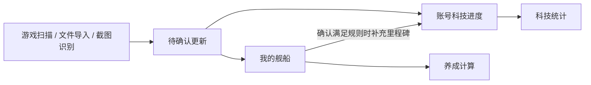

# 舰船数据模块重构计划

更新日期：2026-10-26。

状态：已实现并完成专项验证。本文是后续讨论和维护的固定计划文档；方案调整直接更新本文。实现与验证详情见 [验证记录](fleet-data-refactor-validation.md)。

基线：`test-runs/fleet-analysis-upstream-20261025/source` 中已同步用户本人 `deploy` 修复的实现，以及 `backend.tar` 提取的数据快照。此计划不以远端 `dev` 变动为依据。

现有实现说明见 [舰队数据分析](fleet-analysis.md)。该文档描述当前行为，本文描述重构目标，两者不能混同。

## 1. 重构目标

先重新定义数据含义，再拆分页面。仅整理组件不能消除业务状态层叠。

当前主要问题：

- 当前拥有的舰船与账号累计取得的科技进度混杂；退役舰船不代表失去曾经解锁的科技。
- 扫描、数据维护、分析试算都有编辑入口，正式数据与临时结果的边界不直观。
- 科技页面提供底账、人工、合并等模式，使用户需要理解内部合并规则。

模块统一命名为「舰船数据」，设置四个平级页面，默认进入「我的舰船」：

| 页面 | 回答的问题 |
| --- | --- |
| 我的舰船 | 我目前有哪些船，它们是什么状态？ |
| 舰队科技 | 账号已经解锁哪些科技，还缺什么？ |
| 养成计算 | 把尚需培养的舰种练到120级，需要多少心智单元和物资？ |
| 扫描更新 | 怎样取得新数据，这次更新会改什么？ |

不增加单独的总览页，不再用一个巨大的分析页面嵌套多个完整页面。

## 2. 基本原则

### 2.1 区分舰船种类和具体舰船

两艘企业在图鉴中是一种舰船，在「我的舰船」中是两条独立记录；科技奖励只计算一次，养成资源是否计算两艘由计算范围决定。

舰名不能充当唯一标识。改造形态、基础稀有度、科研分类由图鉴及明确规则关联，不依赖用户手动维护多个互相独立的字段。

### 2.2 正式业务数据只有两类

| 数据 | 含义 | 变化规律 |
| --- | --- | --- |
| 我的舰船 | 当前持有的每艘船及其等级、经验、突破等信息 | 可以新增、更新、退役 |
| 账号科技进度 | 每种舰船已解锁的获取、满星、120 级里程碑，以及阵营科技等级 | 正常情况下累计保留；错误可以明确纠正 |

静态图鉴提供名称、阵营、舰种、形态、费用和奖励规则，不是第三份账号记录。待确认更新是临时工作区，计算条件是方案参数，都不是另一份正式舰船数据。

### 2.3 扫描先确认，统计读取正式数据

扫描只提出更新，确认后才写入正式数据。未确认结果不直接用于统计，各分析页面不保留独立的最新扫描模式。

### 2.4 当前持有变化不抹掉累计科技

确认一艘船达到 120 级，可以补充对应科技里程碑；之后退役该舰船，已确认科技仍保留。

错误通过「纠正科技记录」处理，展示受影响的统计。不能出现用户取消状态后，另一层合并逻辑又悄悄恢复它的情况。纠错与当前舰船事实冲突时，应明确提示关联记录并引导处理。

### 2.5 未知与未完成、零值分开

- 经验未知不等于经验为 0。
- 科技未核实不等于确认尚未解锁。
- 本次没有扫到不等于已退役。
- 满星推断必须依据适用的舰船规则，不能对所有舰船统一套用等级阈值。
- 无法精确计算时，展示缺失信息及估算范围或限制。

### 2.6 正式统计只有一个口径

取消底账统计、人工统计、合并统计的业务模式切换。每个结果可以展开查看依据；来源用于解释结果，不产生另一套正式状态。

计算规则集中维护，前后端遵循同一口径和数据版本，避免重复实现产生偏差。

### 2.7 常用操作直达，技术信息收起

默认页面不展示数据库序号、群组 ID、来源长字符串、原始稀有度等内部字段。舰船表格优先呈现玩家可以直接维护的信息。

页面通过「查看对应舰船」「查看养成计算」「处理待确认更新」直接关联。

## 3. 我的舰船

### 3.1 顶部摘要和操作

- 当前舰船数量，单位为「艘」。
- 不重复舰船种类数，单位为「种」。
- 需要核对的记录数。
- 最近一次确认更新时间。
- 主要操作：「保存」「添加舰船」「扫描更新」。

现有数据样本有 991 条舰船记录，必须区分具体舰船数与种类数。

### 3.2 主表

表格直接原地修改，顶部统一保存。支持搜索、筛选、排序和分页。舰船、等级、突破状态、形态、舰种、阵营、稀有度、核对状态均通过点击表头切换升降序，并显示方向；不再使用独立的“等级／舰名”排序下拉框。排序覆盖筛选后的全部记录，切换排序返回第一页，未知值在两个方向均置后。阵营按图鉴顺序，稀有度按N→R→SR→SSR→UR，突破状态按未满星→已满星→未知；操作列和批量选择列不排序。

| 默认列 | 内容 |
| --- | --- |
| 舰船 | 名称、形态；同名副本显示副本标识 |
| 等级 | 当前等级 |
| 突破状态 | 未满星、已满星、未知，不保存具体突破次数 |
| 形态 | 未知、原始、改造，可直接切换 |
| 舰种 | 驱逐、轻巡等，随身份自动更新 |
| 阵营 | 所属阵营 |
| 稀有度 | 面向玩家的显示值 |
| 核对状态 | 正常、待核对、等级未知；额外经验未知不标记为信息缺失，满星未知由突破状态列单独显示 |
| 操作 | 删除／恢复；保存后生效 |

常用筛选为等级、阵营、舰种、重复舰船和待核对。额外经验暂不展示。

### 3.3 原地编辑与统一保存

- 取消逐条查看／编辑入口及详情侧栏。
- 舰名、等级、突破状态、形态、核对标记可直接在表格中修改。
- 图鉴匹配舰名和形态后，自动更新身份、舰种、阵营和稀有度；未知身份保留待核对。
- 添加舰船生成表格顶部的新行；删除先标记待删除并可恢复。
- 顶部只有一个「保存」按钮，将所有页的修改、新增、删除及批量标记作为一个事务提交。
- 同名副本保持独立；科技和养成页的舰船链接定位并高亮对应行。
- 暂不显示额外经验，已有值保留。

### 3.4 编辑规则

- 翻页、排序及筛选保留修改；输入过程中维持原记录的位置。
- 草稿按实例保存在浏览器会话中，并记录编辑开始时的数据版本；后台更新不覆盖草稿，版本冲突禁止覆盖保存。
- 保存失败保留草稿；放弃草稿恢复正式数据。
- 删除在统一保存后生效，累计科技进度保留。
- 不参与某次养成计算属于计算范围，不作为舰船事实字段。
- 待确认差异不堆在主表下方，只提供「有 N 项更新待确认」入口。

## 4. 舰队科技

### 4.1 顶部摘要

- 已确认科技点数。
- 获取、满星、120 级各阶段的完成数量。
- 尚未核实的项目数量。
- 阵营科技等级概况。

科技全部完成必须有明确条件，不能仅以达到 120 级替代所有里程碑完成。

### 4.2 完整图鉴主表

一种舰船一行，保留完整图鉴。

| 默认列 | 内容 |
| --- | --- |
| 舰船 | 名称、阵营、舰种 |
| 当前持有 | 持有数量、最高等级；没有则显示未持有 |
| 曾经获取 | 已完成、未完成、未核实 |
| 满星 | 已完成、未完成、未核实 |
| 120 级 | 已完成、未完成、未核实 |
| 科技点 | 已确认点数 / 该舰可提供点数 |
| 待解锁收益 | 尚可获得的点数和属性加成 |

「未持有」表示当前舰船表中没有；「未获取」表示确认未取得过获取里程碑。不能用完整图鉴减去当前船坞直接得到历史未获取列表。

### 4.3 筛选和属性加成

优先提供科技尚未完成、未获取、缺满星、缺 120 级、未核实，以及目标属性、舰种、阵营筛选。

属性加成是本页的可展开区域，分别展示舰船科技贡献、阵营科技贡献、总加成和未知数据对完整性的影响。

### 4.4 维护边界

本页允许维护科技事实和阵营等级，不修改当前舰船等级。

点击里程碑可查看依据、补录或纠错。冲突必须展示相关舰船记录及处理路径，不能由隐藏优先级掩盖。

## 5. 养成计算

自动展示计算结果，不要求先选船，也不通过科技页按钮带入范围。

### 5.1 计算范围

- 每个有科技奖励的舰种，自动采用现有最高等级的一艘。
- 已完成累计120级科技的舰种不重复计算，退役不清除累计奖励。
- 最高等级已到120级的舰种不计费。
- 未核实的科技按当前等级估算，保留未核实标记，不改写科技状态。
- 身份待核对和无科技奖励舰种不自动计入。
- 数据更新后自动重新选择最高等级副本并计算。

### 5.2 目标与条件

本轮目标固定为120级，暂不计算经验。手动排除舰种与试算等级、已觉醒上限作为可选调整，均不修改正式数据。排除项按舰种保存，试算按具体副本保存。「恢复自动计算」一键清除调整。旧手动选择列表不再控制自动范围。

### 5.3 结果

摘要只展示心智单元、物资、参与计算数量和信息不足数量。

| 明细列 | 内容 |
| --- | --- |
| 参与计算 | 取消勾选可排除本舰种 |
| 舰船 | 当前最高等级的具体副本 |
| 当前等级 | 正式等级 |
| 心智单元 | 培养至120级的觉醒费用 |
| 物资 | 培养至120级的觉醒费用 |
| 计算说明 / 试算 | 未核实标记、觉醒边界与可选试算 |

不包含突破、强化和科研开发费用。经验原始数据保留，本轮不计算或展示经验需求。

## 6. 扫描更新

按三个顺序区域组织，避免嵌套标签。

### 6.1 开始读取

- 来源：游戏扫描、文件导入、截图识别。
- 游戏扫描范围：完整扫描、指定等级范围。
- 明确列出本次能够读取的字段。
- 开始、停止及必要设备状态。

旧 JSON 迁移放入「导入旧数据」折叠项，不长期占据所有页面顶部。

### 6.2 读取进度

- 当前阶段。
- 已识别数量。
- 身份不明或读数异常数量。
- 是否完整结束。
- 失败或停止原因。

读取完成与更新已保存必须是不同状态。

### 6.3 确认更新

摘要展示新增、变化、疑似缺失和需人工匹配的数量。

| 对象 | 当前记录 | 新读数 | 建议处理 |
| --- | --- | --- | --- |
| 某舰船 | Lv.100 | Lv.105 | 更新等级 |
| 某舰船 | 无对应记录 | Lv.1 | 新增 |
| 同名副本 | 多个可能对象 | Lv.120 | 选择对应副本 |
| 某舰船 | 当前存在 | 完整扫描未发现 | 核对是否移除 |

处理规则：

- 无歧义的新增、更新可批量确认。
- 同名副本必须明确对应关系。
- 移除建议单独确认，不混入全部接受。
- 局部扫描不能提出范围之外的删除建议；整体未满足完整性条件时不能据此删除。
- 未读取字段不覆盖已有值。
- 确认前展示将补充哪些科技里程碑。
- 新扫描不能悄悄替换尚未处理的结果。

第一版保留最近一次读取结果和简短操作摘要，不增加复杂历史批次浏览系统。

## 7. 移除的层叠与实现边界

| 当前设计 | 重构目标 |
| --- | --- |
| 公共扫描面板挂在所有分析页面上方 | 独立扫描更新页面 |
| 科技底账、人工、合并模式 | 一份正式科技进度，按需查看依据 |
| 心智页独立维护舰船列表及导入 | 读取我的舰船，仅维护计算条件 |
| 多页面分别维护身份修正 | 跳转我的舰船对应行原地修改 |
| 默认表格展示来源和内部编号 | 按需提供 |
| 用等级切换模拟科技完成 | 直接维护真实里程碑 |
| 多套报告各自推导正式状态 | 集中业务规则，一致数据版本 |

后端边界为图鉴、当前舰船、科技进度、扫描更新和计算服务。继续使用 SQLite，不为了重构增加事件总线、通用证据平台或额外中间数据库。

## 8. 实施顺序

### 阶段一：确定数据模型和规则

- 明确当前持有、历史获取、满星、120 级、未知状态及副本身份的定义。
- 明确科技补充与纠错规则、冲突处理和统计分母。
- 明确扫描可读取字段及完整性判定。

### 阶段二：用 deploy 数据验证迁移

- 使用 backend 数据的独立副本，不修改原始归档或原始数据库。
- 保留 991 条舰船记录的独立身份及人工信息。
- 旧科技记录能够证明的进度继续保留，无法判断的标记为待核对。
- 对原排除标记等旧字段定义明确去向，不能静默丢弃人工选择。
- 迁移前后逐项对账，统计变化逐项说明原因，不为保持旧总数延续错误推断。

### 阶段三：重建我的舰船和扫描更新

- 打通唯一的正式数据维护流程。
- 完成舰船表格原地编辑和统一保存。
- 验证扫描确认、副本匹配、字段保留和版本冲突处理。

### 阶段四：重建科技统计和养成计算

- 接入正式数据及集中计算规则。
- 移除旧状态链和重复编辑逻辑。
- 旧路由仅负责跳转，不继续维持另一套兼容业务逻辑。
- 更新现有模块说明，使实施后的文档与实际行为一致。

## 9. 验收标准

- [x] 两艘同名船可独立编辑，科技只计算一次。
- [x] 退役最后一艘同名船，累计科技仍保留。
- [x] 局部或不完整扫描不会误删舰船。
- [x] 扫描取消或未确认，不改变正式统计。
- [x] 人工经验不会被扫描的未知值覆盖，未知与 0 保持区别。
- [x] 科技纠错不会在刷新后被另一层状态悄悄恢复。
- [x] 冲突纠错明确展示关联事实及处理方式。
- [x] 试算不修改真实舰船，副本去重规则可见。
- [x] 未持有、未获取、未核实可以分别识别和筛选。
- [x] 每项统计可以解释对象、口径、依据和未知项。
- [x] 迁移保留副本及人工信息，数据差异可核对、可解释。

## 10. 已落实的规则与实现边界

- 满星：逐卡只保存未满星／已满星／未知。新增、修改、确认扫描或导入时强制写入：所有舰船已知等级低于70级为未满星，身份确认的常规舰船高于100级为已满星；科研、META、原生UR不套用高等级规则。70级和100级均不触发强制规则。其余保留已知状态，无依据为未知。旧数据通过schema v5一次性迁移转换，读取时不重复推算；当前未满星不抹除历史科技完成记录。
- 迁移：保存旧科技原始记录，按可靠证据构造三态累计进度；未知状态不伪装成未获取。991 条实际舰船的 ID 和其他原字段保留，旧突破次数在schema v5转换为三态满星状态。
- 纠错：与当前舰船正向事实冲突时事务拒绝，并展示关联副本；修改经验等无关字段不重新应用旧推断。历史依据在退役后仍可查看。
- 导入：JSON/CSV/XLSX 文件和 PNG/JPEG/WebP 截图进入同一待确认流程，不先合并同名副本。扫描未读到的经验、突破和形态不覆盖人工值。
- 方案：自动养成偏好按实例保存在浏览器 localStorage，首次继承最高等级副本的旧排除标记；表格编辑草稿使用 sessionStorage 并保留原版本。
- 费用：页面目标固定120级，按静态图鉴基础稀有度计算心智单元和物资，暂不计算经验；觉醒边界给出估算并允许设置符合当前等级的已觉醒上限。不含突破、强化和科研开发费用。
- 读取状态：展示调度状态及最近成功读取摘要；实时异常详细原因查看现有任务日志，不增加逐帧或复杂历史批次存储。
- 兼容：旧页面路由跳转至四页入口；旧计算 API 保留只读算法兼容，新页面不再使用旧状态链。

核心约束：以当前舰船和累计科技两种事实为中心，扫描统一进入确认流程，养成计算只消费事实与目标。
